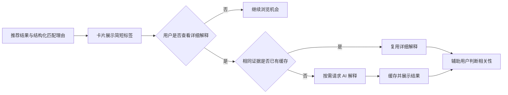
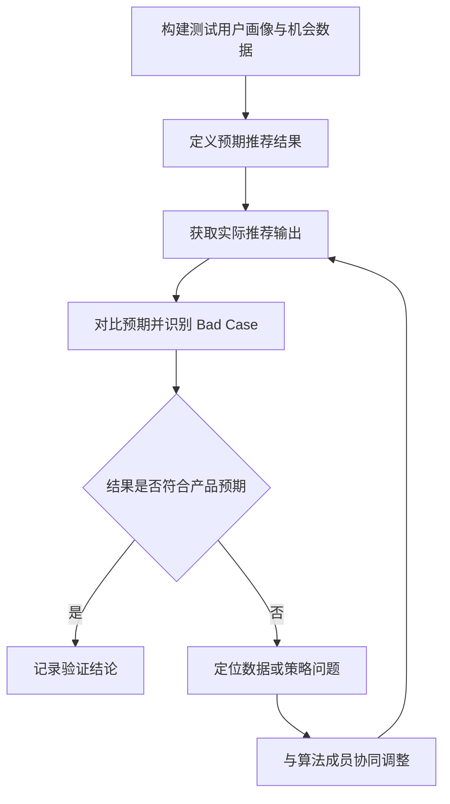

# Scholar Hub｜AI 科研机会推荐产品案例

> 面向科研人员的机会聚合与个性化推荐产品：降低信息检索成本，提升推荐相关性的可感知度，并通过用户反馈持续校准推荐体验。

**[在线体验 Scholar Hub Demo](https://scholar-hub-demo.pages.dev/)**

我在原团队项目中担任 Scrum Master 与 Frontend Lead，工作覆盖需求分析、产品与交互设计、推荐策略验证、前端落地和迭代交付。随后通过 Vibe Coding 将核心推荐体验重构为可独立访问的作品集 Demo，完成原型搭建、交互迭代、功能验证与公开部署。

## 我的核心贡献

| 能力方向 | 关键行动 |
|---|---|
| 需求与产品设计 | 将“发现科研机会”拆解为供给质量、推荐相关性、解释可信度与反馈闭环四类问题。 |
| 推荐策略验证 | 构建用户画像与机会数据测试场景，定义预期结果，开展 Bad Case 分析并协同算法成员调整策略。 |
| AI 产品设计 | 设计分层式 AI 推荐解释机制，在信息效率、可解释性、生成等待与调用成本之间进行取舍。 |
| 平台治理 | 提出机构邮箱域名辅助认证方案，推动多源异构数据标准化及业务事件驱动的通知体系设计。 |
| 产品落地 | 负责关键前端体验实现，并将核心推荐产品设计转化为可交互、可验证的独立产品原型。 |

## 业务问题

Grant、Scholarship、Internship、Conference 与 Fellowship 分散在不同渠道，字段口径、时效性和发布主体也不一致。科研人员不仅需要“搜到机会”，还需要快速判断机会是否适合自己、理解推荐依据，并能纠正不符合真实意图的结果。

Scholar Hub 因此围绕一条完整产品链路展开：**可信机会供给 → 数据标准化 → 个性化匹配 → 推荐解释 → 用户反馈 → 策略验证**。

## 核心产品设计

### 1. 科研机会供给与数据治理

多来源机会会带来字段不一致、机构身份可信度和审核效率问题。我推动从“增加数据量”转向“提升可用供给质量”：

- **主动提出**机构邮箱域名辅助认证方案，将域名作为身份核验信号之一，并结合资料与审核流程降低发布风险；
- **协同制定并迭代** Canonical Field Mapping，将多源研究领域映射到统一口径，为搜索、筛选与推荐提供一致输入；
- **独立设计**业务事件驱动的英文通知体系，覆盖 **2 类通知场景、6 个触发节点**，连接机构认证、机会审核与状态反馈；
- 持续关注机会来源覆盖、有效期和数据质量，使供给侧数据能够真正进入后续推荐链路。

### 2. 个性化推荐策略分析

我通过推荐策略测试场景构建，将产品预期转化为可对比的测试案例。

| 测试场景 | Bad Case | 产品判断 | 推动动作 |
|---|---|---|---|
| 用户偏好多种机会类型 | 推荐结果的类型分布不合理 | 相关机会数量不等于结果结构合理，需要兼顾用户偏好与类型覆盖 | 与算法成员分析候选分布，推动类型交错规则并复验 |
| 高相关但已过期的机会 | 过期内容仍可能进入结果 | 推荐必须同时满足相关性与可申请性 | 推动加入有效期过滤，并用边界场景验证 |
| 用户研究兴趣与机会字段匹配 | 部分结果与预期研究方向存在偏差 | 需要检查字段标准化、关键词和匹配证据，而非只看最终分数 | 对比预期与实际结果，定位 Bad Case 并协同调整 |

建立以用户价值为导向的推荐策略验证机制，将数据质量、匹配逻辑与推荐结果纳入统一验收流程。

### 3. AI 推荐可解释性与调用成本控制

用户需要知道“为什么推荐给我”，但解释深度会直接影响阅读效率和模型成本。我比较了三种方案：

| 方案 | 用户体验 | 产品取舍 |
|---|---|---|
| 仅展示关键词 | 扫读快，但难以理解完整关联 | 成本低，解释深度不足 |
| 默认展示完整解释 | 信息充分，但列表负担重 | 可能产生不必要的等待与模型调用 |
| **分层展示 + 按需生成** | 先看匹配标签，需要时再展开 | 平衡判断效率、解释深度与调用成本 |

最终采用 **2 层推荐解释结构**：第一层在卡片展示结构化匹配理由；第二层由用户主动触发详细解释。原团队实现按需请求，并基于相同证据复用缓存结果，减少重复生成及解释波动。

### 4. 用户反馈机制

“研究方向相关”并不等于“用户感兴趣”。我将 Not Interested 定义为**显式负反馈与可撤销交互机制**：

- 入口只作用于个性化推荐区，不删除原始机会，避免影响分类浏览；
- 操作后即时隐藏当前结果，并切换详情，缩短用户清理低价值内容的路径；
- 提供 Undo 与 Restore all，降低误操作成本并保留用户控制权；
- 将隐藏行为视为潜在策略信号，而不是直接推断用户永久排斥某个领域或类型。

当前 Demo 已落地隐藏、Undo、原顺序恢复、localStorage 持久化和全部恢复，形成可直接体验的本地反馈闭环。

### 5. 推荐策略验证与迭代

我将推荐验收组织为“预期—实际—异常—调整—复验”的闭环，推动产品、数据与算法协同。

## 交付成果

- **业务覆盖：** 围绕 Grant、Scholarship、Internship、Conference、Fellowship **5 类科研机会**，串联 Scholar、Institution User 与 Administrator 的发现、供给和治理流程；
- **数据与平台治理：** 推动机构辅助认证、Canonical Field Mapping 和审核通知形成可协作的治理链路；
- **推荐策略验证：** 建立覆盖相关性、有效期、类型分布与匹配证据的测试方法，将 Bad Case 推进到定位、协作调整与复验；
- **AI 产品设计：** 交付 **2 层推荐解释结构**，结合按需生成与缓存复用，平衡可解释性、阅读效率和调用成本；
- **业务通知设计：** 独立设计 **2 类通知场景、6 个触发节点**，连接关键业务状态与用户反馈；
- **独立 Demo 落地：** 通过 Vibe Coding 重构核心推荐体验，完成交互迭代、功能验证与在线发布。

后续效果评估可围绕推荐相关性、有效机会点击、解释展开与有用性、隐藏率、撤销率及反馈后的推荐变化建立指标体系。

## 项目边界

本作品集聚焦 Scholar Hub 的产品设计、推荐策略、AI 可解释性及用户反馈机制。

在线 Demo 采用模拟数据独立构建，用于展示核心产品交互与设计方案，不连接原项目服务。

基于知识产权及保密要求，原项目源代码、内部数据及开发资料不对外公开。
